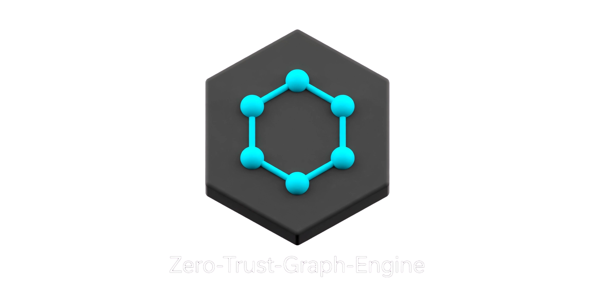

# ****PREDATOR**** 
<p align="right">  </U> 

[](https://github.com/dcpracmatic-prog/PREDATOR/actions/workflows/ci.yml)

**es un motor de optimización y análisis de grafos con interfaces HTTP y MCP.**

Combina heurísticas en C++ (`MORPH`) con un pipeline de detección, auditoría y verificación reutilizable desde Python. Los informes existentes conservan sus identificadores `ztge.audit.v1` y `ztge.envelope.v1` para mantener compatibilidad.

## Características principales

- **Latencia acotada:** `MORPH` respeta un presupuesto de tiempo configurable (p. ej. 50–100 ms); el tiempo de pared se mantiene cerca de ese techo en grafos grandes.
- **Enrutamiento inteligente (`auto`):** elige `GWMIN` (puro Python, muy rápido) cuando el grafo es pequeño (`n < 1500` por defecto) y `MORPH` cuando escala o el binario está disponible.
- **Verificación de correctitud:** todo conjunto independiente se revalida con un predicado puro (`is_independent`) antes de aceptarse en informes o APIs.
- **Informes auditables (opcional):** esquema `ztge.audit.v1` y sobre firmado HMAC/Ed25519 para consumo por terceros (`docs/SIGNED_REPORTS.md`).

---

## Requisitos

- Python ≥ 3.10
- MCP: paquete oficial de Python `mcp` (opcional, solo para el adaptador MCP)
- Compilador C++17 (`g++`) para construir `dump_morph`
- Opcional: `pyyaml`, `ortools` (benchmarks exactos), `cryptography` (firmas Ed25519)

---

## Instalación

```bash
git clone https://github.com/dcpracmatic-prog/Zero-Trust-Graph-Engine.git
cd Zero-Trust-Graph-Engine

# Binario MORPH
make build-morph
export MORPH_DUMP_BIN="$(pwd)/vendor/morph_src/dump_morph"
# Si el sistema de archivos no permite ejecutar desde el árbol del repo:
# cp vendor/morph_src/dump_morph /tmp/dump_morph && chmod +x /tmp/dump_morph
# export MORPH_DUMP_BIN=/tmp/dump_morph

# Paquete editable
pip install -e ".[yaml,dev]"
```

Comprueba el entorno:

```bash
PYTHONPATH=vendor/clan_src python -m clan_subnet_detector.cli --status
```

---

## Uso rápido

```python
from clan_subnet_detector import Graph, plan_independent, is_independent

# 1. Grafo no dirigido a partir de aristas (nodos 0..n-1)
g = Graph.from_edges(5, [(0, 1), (1, 2), (2, 3)])

# 2. Conjunto independiente con selección automática
solution = plan_independent(g, method="auto", budget_ms=50, seed=1)

# 3. Verificar correctitud
assert is_independent(g, solution)
print("Conjunto independiente:", solution)
```

### Métodos del planificador

| `method` | Comportamiento |
|----------|----------------|
| `auto` | `GWMIN` si `n < auto_n_threshold` (1500); si no, `MORPH` cuando el binario existe |
| `gwmin` | Solo heurística Python (siempre disponible) |
| `morph` | Solo binario `dump_morph`; si falla, el planificador puede degradar a `GWMIN` |

```python
from clan_subnet_detector import plan_independent

trace = []
S = plan_independent(
    g,
    method="auto",
    budget_ms=100,
    seed=42,
    trace_out=trace,
)
print(trace[0]["resolved"], trace[0]["reason"])
```

### Auditoría con informe (JSON / Markdown / sobre firmado)

```python
from clan_subnet_detector import Graph, run_audit, write_report
import os

g = Graph.from_edges(6, [(0, 1), (1, 2), (2, 3), (3, 4)])
report = run_audit(g, method="auto", budget_ms=50, seed=1)

os.environ["ZTGE_HMAC_SECRET"] = "hex:" + "ab" * 32  # ejemplo; use un secreto real
paths = write_report(report, "out/", sign=True, key_id="hmac:dev")
print(paths)  # json, markdown, signed
```

---

## CLI

```bash
predator-status
predator-detect --help
predator-detect --status
```

---


## Interfaces: HTTP y MCP

La API HTTP se mantiene para integraciones existentes:

```bash
predator-api --port 8080
# Alias legacy: ztge-api --port 8080
# OpenAPI: http://127.0.0.1:8080/openapi.json
```

El servidor MCP usa stdio y el mismo núcleo validado (`plan` y `audit`):

```bash
predator-mcp
```

Instálalo con `python install.py` o `python -m pip install -e ".[mcp]"`. Después configura el cliente MCP para lanzar el comando `predator-mcp` desde el entorno donde instalaste PREDATOR. El detalle de la configuración depende del cliente; el servidor no solicita tokens web ni conecta bases de datos por su cuenta.

Documentación HTTP: [docs/API.md](docs/API.md) · especificación [openapi/openapi.yaml](openapi/openapi.yaml).

## Benchmarks locales

Un solo script genera CSV, JSON, Markdown y gráficos en `results/<UTC>_<commit>/`:

```bash
python benchmarks/run_benchmark.py --mode scaling
python benchmarks/run_benchmark.py --mode pareto
python benchmarks/run_benchmark.py --mode exact          # óptimo n≤24 (DP) / OR-Tools si está
python benchmarks/run_benchmark.py --mode all --quick

# Pareto en ER denso (grado medio ≈ 12)
make bench-pareto-dense
```

Opciones útiles: `--families ER,BA,GRID`, `--avg-deg-list 3,6,12`, `--budgets 10,50,100,500`.

Notas de diseño y lecturas de rendimiento: `docs/PARETO_ER_D12.md`, `docs/ARCHITECTURE.md`.

---

## Estructura del repositorio

```
vendor/clan_src/     # Paquete Python (planificador, auditoría, grafo)
vendor/morph_src/    # Fuentes C++ de MORPH → dump_morph
vendor/cw_zero/      # Contratos / generador de adaptadores
contracts/           # Contratos YAML declarativos
schemas/             # JSON Schema de informes firmados
benchmarks/          # run_benchmark.py
docs/                # Arquitectura, packaging, reportes firmados
```

---

## Documentación adicional

- [Auditoría de consolidación y criterios de aceptación](docs/CONSOLIDATION_AUDIT.md) — riesgos técnicos pendientes, orden de corrección y condiciones para declarar una versión consolidada.

| Documento | Contenido |
|-----------|-----------|
| [docs/ARCHITECTURE.md](docs/ARCHITECTURE.md) | Capas del motor |
| [docs/PACKAGING.md](docs/PACKAGING.md) | Listo para SDK / API B2B |
| [docs/SIGNED_REPORTS.md](docs/SIGNED_REPORTS.md) | Esquema `ztge.audit.v1` y sobres HMAC/Ed25519 |
| [docs/PARETO_ER_D12.md](docs/PARETO_ER_D12.md) | Calidad vs presupuesto en grafos densos |

---

## Limitaciones

- `MORPH` es una **heurística con presupuesto de tiempo**, no un solver exacto de MIS.
- Los benchmarks publicados usan grafos sintéticos (ER, BA, rejilla); valide en sus datos reales.
- La reconfiguración autónoma de redes queda fuera del alcance de este empaquetado.

---

## Licencia

Este proyecto se distribuye bajo los términos de la **GNU Affero General Public License v3.0 (AGPL-3.0)**. Consulte el archivo [`LICENSE`](LICENSE) para el texto completo.


### Portable hardware validation

Run `predator-hardware-profile --output hardware-profile.json` on the host that will serve agent requests. It records visible CPU/memory, MORPH availability, solution validity, measured wall time and candidate MORPH budgets for tested graph sizes. Candidate budgets are empirical for that host and calibration workload; they do not claim optimality or silently override an API request. The API body limit defaults to a resource-aware estimate (1–64 MiB when memory is detected, with a 1 MiB fallback when it is unknown); on very small-memory hosts the computed cap can be lower. These heuristics are not an RSS guarantee. Set `PREDATOR_MAX_REQUEST_BYTES` to a measured, explicit value when appropriate.
